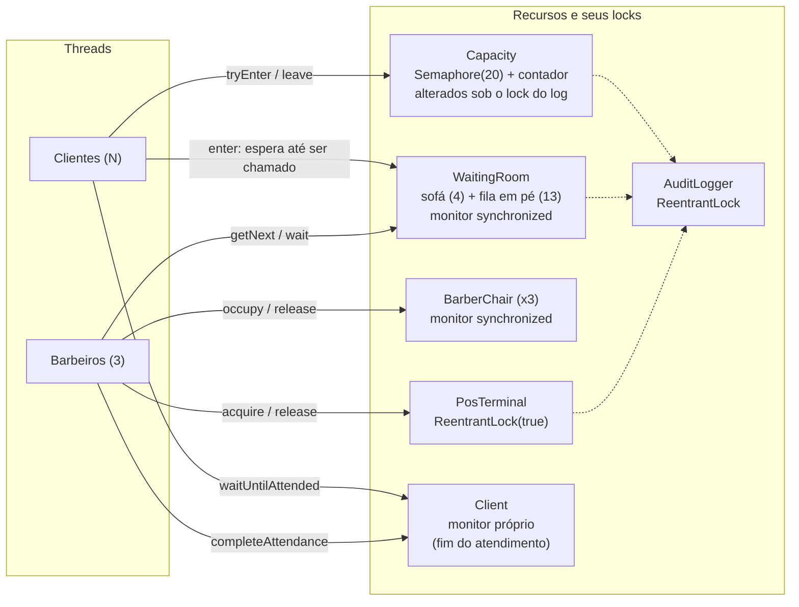
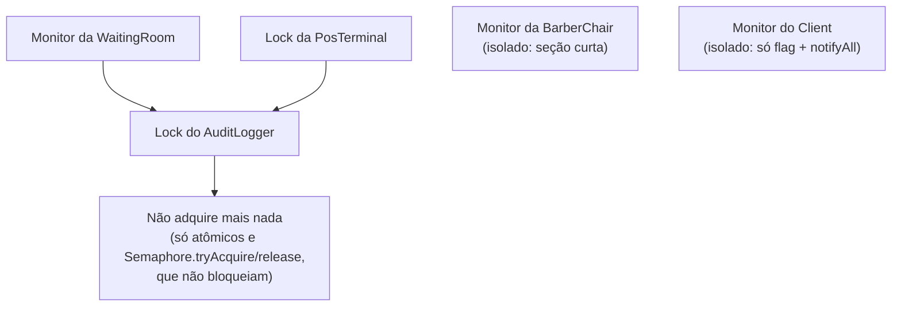
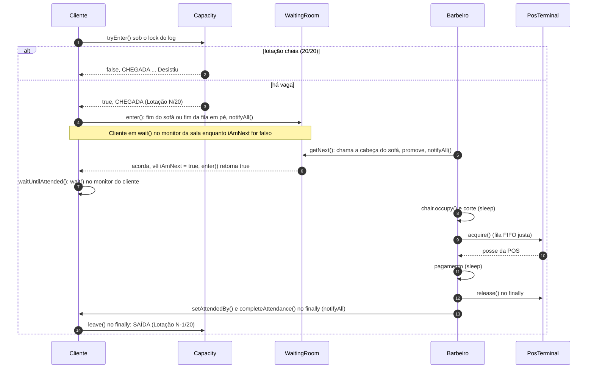
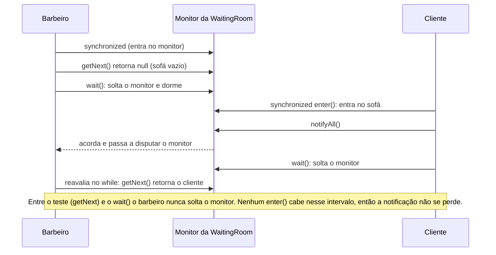
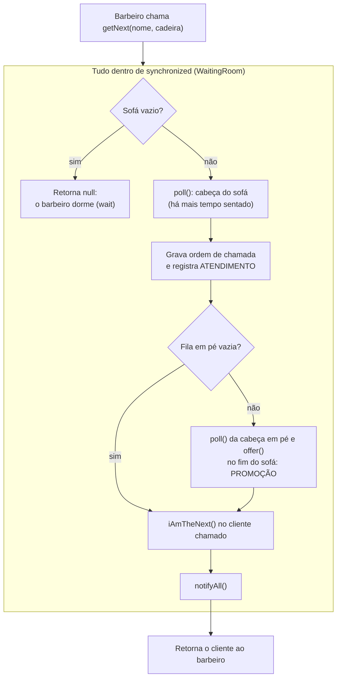
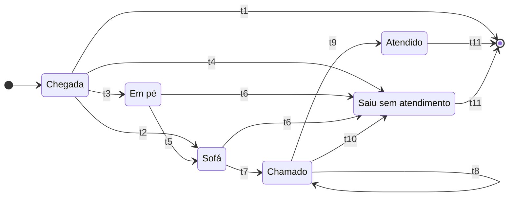
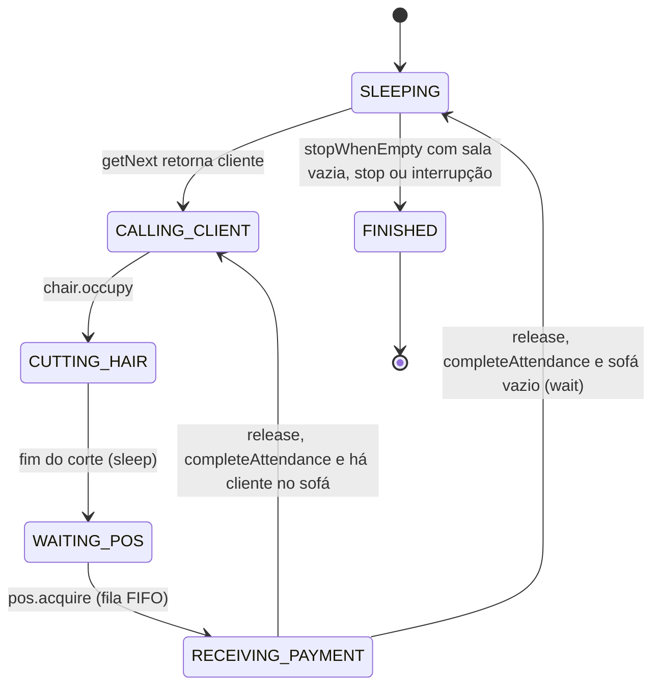
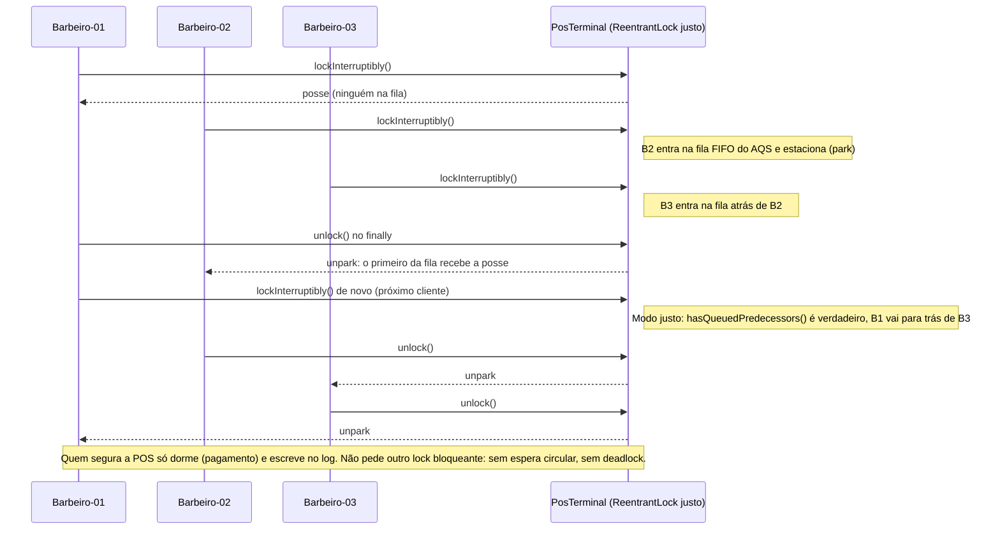

# Diagramas de sincronização

Diagramas da arquitetura de sincronização, fiéis ao código atual (`Barber`, `Client`, `WaitingRoom`,
`Capacity`, `PosTerminal`, `AuditLogger`). Estão em Mermaid: o GitHub e o VS Code (com extensão de
Mermaid) os renderizam direto. Para o relatório, dá para exportar cada um como imagem em
[mermaid.live](https://mermaid.live).

---

## 1. Recursos compartilhados e quem os protege

Cada estado compartilhado tem exatamente um lock "dono". As setas tracejadas indicam que o recurso escreve no
log enquanto segura o próprio lock.

---

## 2. Ordem de aquisição de locks (por que não há deadlock)

Uma seta A → B significa "B é adquirido enquanto A está retido". O grafo não tem ciclo, logo não há espera
circular, que é condição necessária para deadlock. Os monitores da cadeira e do cliente nunca são retidos
enquanto se pede outro lock.

---

## 3. Ciclo de vida completo de um cliente

A vaga na `Capacity` é obtida na chegada e só devolvida no último passo. Durante toda a passagem pelo sofá,
pela fila em pé e pela cadeira, o cliente conta como 1 dos 20; por isso as promoções entre filas não alteram
a lotação.

---

## 4. Barbeiro dormindo sem lost wake-up

O mesmo padrão (testar a condição num `while` e dormir no mesmo monitor de quem a altera) vale para o cliente
esperando ser chamado (monitor da sala) e esperando o fim do atendimento (monitor do próprio cliente).

---

## 5. `getNext()`: chamada e promoção atômicas (FIFO em dois níveis)

Invariante mantida: **fila em pé não vazia ⇒ sofá cheio**. Ninguém novo senta no sofá enquanto há alguém em
pé esperando, então a ordem de chamada é igual à ordem de entrada na sala. Quem decide o próximo é o barbeiro
(marcando `iAmNext`); os clientes acordados pelo `notifyAll()` que não foram marcados voltam a dormir, então
a disputa pelo monitor (que não é justo) não altera a ordem.

---

## 6. Estados do cliente

| Transição | Quando acontece | Onde |
| --- | --- | --- |
| t1 | Lotação 20/20: desiste na hora (`CHEGADA ... Desistiu.`) | `Capacity.tryEnter` |
| t2 | Há vaga e o sofá tem lugar | `WaitingRoom.enter` |
| t3 | Há vaga e o sofá está lotado | `WaitingRoom.enter` |
| t4 | Sala cheia (17): caminho defensivo, raro | `WaitingRoom.enter` |
| t5 | Promoção: era a cabeça da fila em pé quando um barbeiro chamou alguém | `WaitingRoom.getNext` |
| t6 | Interrompido antes de ser chamado; se estava no sofá, o primeiro em pé é promovido | `WaitingRoom.enter` (catch) |
| t7 | Era a cabeça do sofá: barbeiro marca `iAmNext` | `WaitingRoom.getNext` |
| t8 | Interrompido depois de chamado: segue para o atendimento (gap 7) | `WaitingRoom.enter`, `Client.waitUntilAttended` |
| t9 | Corte e pagamento concluídos | `Barber.serve` |
| t10 | Barbeiro interrompido ou falhou: o `finally` destrava o cliente | `Barber.serve` (finally) |
| t11 | Devolve a vaga e registra `SAÍDA` (com o barbeiro ou com o motivo) | `Client.run` (finally) |

---

## 7. Estados do barbeiro (`BarberState`)

Em `SLEEPING` a thread está em `wait()` no monitor da sala: bloqueada de verdade, sem consumir CPU.

---

## 8. Disputa pela POS com lock justo

Um pagamento por vez é garantido pelo lock único; o pico de pagamentos simultâneos medido em todos os testes
foi 1. A justiça impede que um barbeiro (e o cliente que ele atende) seja preterido indefinidamente na POS.
